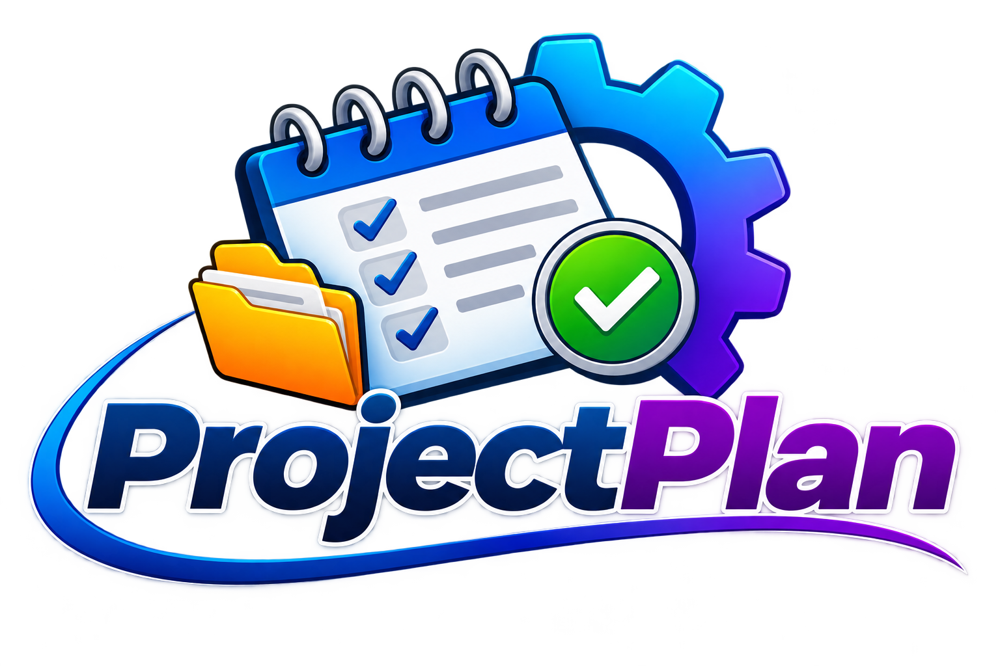

<div align="center">
  

  <h1>ProjectPlan</h1>
  <p><strong>Plan projects. Track progress. Preserve the knowledge.</strong></p>
</div>

---

## Project Overview

ProjectPlan is a Laravel-based project planning and documentation platform for organizing the lifecycle of websites and applications. Each project will have a structured storyboard, project outline, phases, milestones, tasks and subtasks, requirements, technical documentation, development history, and future ideas—all stored in the database so plans and decisions remain available as work continues over time. The system is intended to serve as the central planning workspace for Laravel projects maintained in GitHub, helping the team resume work confidently, understand how each site is designed, and avoid losing important implementation details.

## System Requirements

| Component | Requirement |
|---|---|
| PHP | 8.3.28 or compatible PHP 8.3 release |
| Laravel | 13.x |
| Database | MySQL |
| Composer | Current compatible release |
| Node.js | LTS release compatible with the project's Vite setup |
| npm | Included with Node.js |
| Front-end | Tailwind CSS, Vite |
| Source control | Git and a GitHub repository |
| Web server | Apache or Nginx for production; Laravel's development server for local development |

> These are the baseline requirements. Exact package versions are defined by `composer.lock` and `package-lock.json` in the repository.

## Installation Guide

### 1. Clone the GitHub repository

Replace the repository URL below with the actual ProjectPlan GitHub URL.

```bash
git clone https://github.com/YOUR-USERNAME/YOUR-REPOSITORY.git
cd YOUR-REPOSITORY
```

### 2. Install PHP dependencies

```bash
composer install
```

### 3. Configure the environment

```bash
copy .env.example .env
php artisan key:generate
```

Open `.env` and configure the database connection:

```dotenv
DB_CONNECTION=mysql
DB_HOST=127.0.0.1
DB_PORT=3306
DB_DATABASE=projectplan
DB_USERNAME=your_database_user
DB_PASSWORD=your_database_password
```

Create the `projectplan` database in MySQL before continuing.

### 4. Run database migrations

```bash
php artisan migrate
```

If the repository includes seeders for initial roles, permissions, or development data, run the documented seeding command for those seeders.

### 5. Install and build front-end assets

```bash
npm install
npm run build
```

During development, use:

```bash
npm run dev
```

### 6. Start the Laravel development server

```bash
php artisan serve
```

Open the local URL shown in the terminal, usually:

```text
http://127.0.0.1:8000
```

## Branding Guide

ProjectPlan's visual identity is based on the logo's blue-to-purple gradient, with green for completed or successful actions and warm yellow for folders and planning elements.

### Brand colors

| Name | Hex | Intended use |
|---|---|---|
| Project Blue | `#1456B8` | Primary buttons, links, active navigation |
| Deep Navy | `#102B59` | Headings, dark text, strong contrast |
| Plan Purple | `#7026D9` | Secondary brand accent, highlights |
| Bright Blue | `#0EA5E9` | Focus states, informational accents |
| Success Green | `#22C55E` | Completed tasks, success indicators |
| Folder Amber | `#F59E0B` | Planning/folder accents, warnings |
| Surface | `#F8FAFC` | Main light background |
| Border Gray | `#E2E8F0` | Table borders, card outlines |
| Body Text | `#1E293B` | Standard text |
| Muted Text | `#64748B` | Secondary labels and descriptions |

Use the blue and purple gradient sparingly for prominent brand moments, such as the dashboard welcome panel or primary brand accent. Keep most application surfaces neutral for readability.

### Typography

| Use | Font | Suggested weight |
|---|---|---|
| Page titles and headings | Inter | 600–700 |
| Body text and forms | Inter | 400–500 |
| Buttons and navigation | Inter | 500–600 |
| Code, paths, technical details | JetBrains Mono | 400–500 |

Use a practical system fallback stack if the fonts are not bundled:

```css
font-family: Inter, ui-sans-serif, system-ui, -apple-system, BlinkMacSystemFont,
             "Segoe UI", sans-serif;
```

### Buttons

| Button type | Appearance | Use |
|---|---|---|
| Primary | Project Blue background, white text | Create, Save, Submit |
| Secondary | White/surface background, blue text and border | Cancel, Back, View |
| Accent | Plan Purple background, white text | Special actions or key project workflows |
| Success | Success Green background, white text | Mark complete, approve |
| Danger | Red background, white text | Delete or destructive actions |
| Disabled | Muted background and text | Unavailable actions |

Buttons should have consistent height, padding, rounded corners, hover states, visible keyboard focus, and clear labels. Destructive actions should be visually distinct and require confirmation when appropriate.

### Tables and layouts

- Use clean, responsive tables with clear column headings and subtle row dividers.
- Keep table headers visually distinct using a light neutral surface and medium-weight text.
- Use compact status badges for project, phase, and task statuses.
- Align dates and numeric values consistently.
- On small screens, allow horizontal scrolling or switch to a stacked card layout.
- Use consistent spacing, card borders, and rounded corners across dashboards and forms.
- Maintain accessible contrast and do not rely on color alone to communicate status.

### Logo usage

- Main logo file: `public/projectplan-logo.png`
- Use the logo on the login screen, application branding area, README, and project documentation.
- Preserve its transparent background and aspect ratio.
- Do not stretch, recolor, crop, or place it on a background that reduces legibility.
- For compact navigation or favicon use, create a separate icon-only variant rather than shrinking the full wordmark until it becomes unreadable.

## Repository and Project Documentation

GitHub is the source-control home for ProjectPlan's application code and project documentation.

- Keep this `README.md` at the repository root.
- Keep the main logo at `public/projectplan-logo.png`.
- Commit migrations, seeders, application code, and documented setup changes.
- Keep `.env` and credentials out of GitHub; commit `.env.example` with safe placeholders.
- Use GitHub issues or the ProjectPlan task system to track planned work and defects.
- Record significant architecture and implementation decisions in the project's documentation.

## Development Status

ProjectPlan is at the foundation stage. The initial development focus is the project workspace and the database-backed structure for projects, storyboards, plans, phases, milestones, tasks, documentation, and development history.
